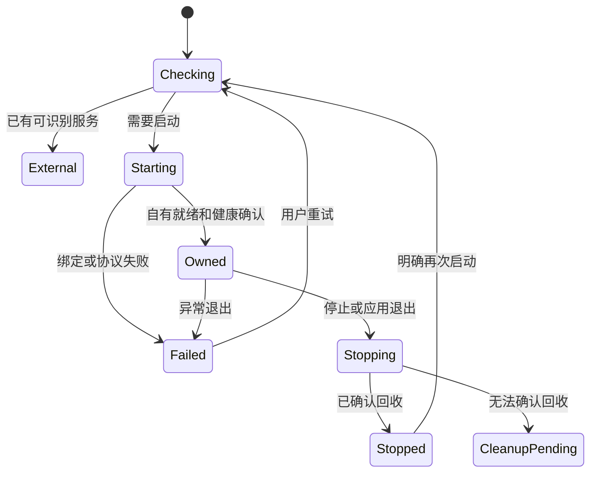

# 界面与跨入口功能逐项审计 · 2026-10-30

## 审计范围与证据边界

本文件审计旧覆盖表中实际存在的 **47 项需求**：REQ-001—005、REQ-050—086、REQ-100—104。没有补造 REQ-087—089 或其他空号，也没有把未实现需求从完整配方中移除。每行的下一项验收是可执行的增量入口，不替代该需求的完整正文和失败边界。

- 源码固定在 `338c9328428d95c5cc776c04b713c09c7b9c5d28`；其内容树与此前通过验证的 `452d59e` 相同，审计时 `git diff --stat 452d59e 338c9328428d95c5cc776c04b713c09c7b9c5d28` 无差异。
- 配方父仓库基线为 `487eda5ef4afce9b96d1305e8d9252bdd05ee828`。本文引用该基线的完整 REQ 正文、`ACCEPTANCE.md`、`UI_REFERENCE.md`、`UI_DIRECTION.md` 与 `PARITY_VERIFICATION.md`。
- 这是只读源码审计及已有证据复核，**没有重新运行 Cargo 测试、真实账户、原版程序或操作系统窗口验收**。唯一新增文件是本文。
- 最近一次已记录的原版 UI 源码参考是 `yetone/magpie@dca3e2d716fe21bbb3e239f769a8e7861b135c01`，见 [原版对齐报告](provider-ui-parity-2026-10-30.md) 与 [机器结果](../tests/results/provider-ui-parity-2026-10-30.json)。最新官方 changelog 的完整版本区间和 pin 尚待本轮主任务固化；本文不把旧参考称为最新完整功能证明。
- “部分”表示有可指出的真实行为；“前置”表示仅有协议、计算或安全基础；“未实现”表示未找到该产品工作流。三者均不等于该 REQ 全部通过。测试总数、渲染图数量和命令存在不能替代逐条端到端验收。

### 完整配方映射

下列路径相对于配方父仓库，不是源仓库内的实现文件。它们及相应配方的 `BUILD_PROMPT.md`、`ACCEPTANCE.md` 构成完整合同；表格中的摘要只用于定位。

| 代号 | 完整规格 | 本文对应编号 |
| --- | --- | --- |
| G | `recipes/magpie/GLOBAL.md` | 001—005 |
| U | `recipes/magpie-gateway/specs/05-usage-and-sessions.md` | 050—059 |
| P | `recipes/magpie-gateway/specs/06-plugins-and-tools.md` | 060—069 |
| L | `recipes/magpie-core/specs/07-library-sync-and-backup.md` | 070—079 |
| I | `recipes/magpie-interfaces/specs/08-cli-tui-and-web.md` | 080—086 |
| V | `recipes/magpie-interfaces/specs/10-visual-and-localization.md` | 100—104 |

Gateway 建议同时受 `recipes/magpie-gateway/specs/03-gateway-and-protocols.md` 的 REQ-030、035、036 约束。本次不重复给这些编号判定完整覆盖。

### 源码和入口索引

| 代号 | 可复核位置 | 实际边界 |
| --- | --- | --- |
| S0 | [core 模块](../crates/magpie-core/src/lib.rs)、[service 模块](../crates/magpie-service/src/lib.rs)、[CLI 分派](../crates/magpie-cli/src/main.rs)、[桌面 Page/导航](../apps/desktop/src/ui.rs) | CLI 只有 agents、ls、config、models、providers、gateway inspect、gui、serve、status 等已分派命令；桌面实际页面只有 Agents、Providers、Settings。没有独立 Usage、Session、Plugin、Library、Backup、Web、TUI 产品实现。 |
| S1 | [Agent 探测](../crates/magpie-core/src/agents.rs)、[目录](../crates/magpie-core/src/agent_catalog.rs)、[桌面快照](../apps/desktop/src/snapshot.rs) | 可执行文件探测和 Codex 有界配置读取；命中命令不等于该 Agent 可配置或在线。 |
| S2 | [Codex 编辑](../crates/magpie-core/src/codex_config.rs)、[事务](../crates/magpie-core/src/codex_transaction.rs)、[桌面动作状态](../apps/desktop/src/actions_state.rs) | 预览、显式应用、归属/漂移检查和离线断开恢复，仅覆盖 Codex 写入。 |
| S3 | [ProviderStore](../crates/magpie-core/src/provider_store.rs)、[凭据](../crates/magpie-core/src/credentials.rs)、[Provider CLI](../crates/magpie-cli/src/providers.rs)、[Provider 页面](../apps/desktop/src/providers.rs) | 多 Provider 的公共配置、单凭据、模型列表、显式模型发现、启停/删除及 revision 冲突。不是多账户、额度或插件存储。 |
| S4 | [Gateway](../crates/magpie-service/src/forward.rs)、[共享配置源](../crates/magpie-service/src/forward/source.rs)、[HTTP 入口](../crates/magpie-service/src/http.rs)、[基础监听器](../crates/magpie-service/src/gateway.rs) | 真实 loopback HTTP/SSE 服务、共享 Provider 热读、健康/目录和有限传输计数；没有持久化账本。 |
| S5 | [协议转换](../crates/magpie-service/src/protocol.rs)、[响应转换](../crates/magpie-service/src/protocol/response.rs)、[流转换](../crates/magpie-service/src/protocol/stream.rs)、[路由纯计算](../crates/magpie-core/src/routing.rs) | 保留可转换的 usage 字段并进行有界流转换；路由使用调用方传入的合成/领域快照。没有据此自动生成真实额度或账单。 |
| S6 | [原生入口](../apps/desktop/src/main.rs)、[UI](../apps/desktop/src/ui.rs)、[偏好](../apps/desktop/src/preferences.rs)、[语言](../apps/desktop/src/localization.rs)、[主题](../apps/desktop/src/theme.rs)、[输入](../apps/desktop/src/text_input.rs) | GPUI 主窗、宽/窄布局、五语主要字符串、主题/语言持久化、输入和焦点；没有 tray、单实例、自动更新或设置搜索。 |
| S7 | [受限 CLI bridge](../apps/desktop/src/cli_bridge.rs) | 固定版本、受控可执行路径和文件指纹、有界 stdout/stderr、20 秒请求期限、取消与子进程回收；全局只允许一个短命令工作流。 |
| S8 | [打包脚本](../scripts/package-release.py)、[发布构建](../scripts/build-release.sh)、[安装说明](../packaging/INSTALL.md)、[工作流](../.github/workflows/package-release.yml) | 有平台分发基础；不能据此声明当前变更已在全部 OS 安装运行，也不能将安装器当作应用内更新器。 |

### 已有验证证据索引

| 代号 | 证据 | 能证明什么 / 不能证明什么 |
| --- | --- | --- |
| E1 | [2026-10-30 机器结果](../tests/results/provider-ui-parity-2026-10-30.json) 与 [解释报告](provider-ui-parity-2026-10-30.md) | 记录 Linux workspace 298 passed、桌面 68 passed、独立 Secret Service 7 项、中文 48 / 德语 12 个实际 GPUI Scene。是已提交记录，本次未重跑；不证明所有 REQ 或用户视觉认可。 |
| E2 | [Agent 目录测试](../crates/magpie-core/tests/agent_catalog.rs)、[旧 CLI 配对测试](../crates/magpie-cli/tests/legacy_agent_candidates.rs)、[共享快照测试](../crates/magpie-cli/tests/desktop_snapshot.rs)、S1 内单元测试 | 探测边界、已观察命令字节、Codex 提交/恢复与快照一致、读失败保留旧值且标旧；不是 68 类 Agent 配置操作完成。 |
| E3 | [Codex 事务测试](../crates/magpie-core/tests/codex_transaction.rs)、S2 `actions_state` 测试、[历史真实 Codex 记录](../tests/results/native-codex-2026-10-29.json)、[历史桌面动作记录](../tests/results/desktop-actions-2026-10-29.json) | 当前组件回归与相应历史固定版本的真实客户端路径。历史安装版 Codex 协调测试在 E1 本轮没有重新执行，不能称为新一轮实机通过。 |
| E4 | [Provider CLI 测试](../crates/magpie-cli/tests/providers_cli.rs)、[模型发现 HTTP 测试](../crates/magpie-service/tests/provider_catalog_http.rs)、S3 页面中的三个 GPUI 状态测试、[Secret Service 脚本](../scripts/verify-provider-keyring.py) | 持久化 CRUD、失败保留、显式刷新、密钥与独立网关进程、搜索过滤后焦点回退；不验证真实外部供应商账户。 |
| E5 | [跨协议 HTTP 测试](../crates/magpie-service/tests/forward_protocol_http.rs)、[目录 HTTP 测试](../crates/magpie-service/tests/catalog_http.rs)、S4/S5 的测试 | 有限协议和 transport 计数、取消及目录边界。`/health` 明示 `usage_accounting=not_implemented`，计数不是 Usage 账单。 |
| E6 | S6 偏好/输入测试、S7 的 `real_isolated_process_protocol_deadline_cancel_output_and_reaping` | 偏好冲突、坏文件保留、输入模型、遮蔽与剪贴板、短命令取消和回收；不是长期 Gateway 子进程生命周期测试。 |
| E7 | [生产组件 Scene 导出器](../apps/desktop/examples/render_preview.rs)、E1 的输入哈希/PNG 指纹/manifest 摘要 | 实际原生文字、SVG、浅深色及 360/440/900/1280 布局的离屏像素；不是操作系统输入、IME、读屏或托盘验收。 |
| E0 | S0 模块/命令/Page 清单及对应规格核对 | 未找到该产品路径的直接实现和对应端到端测试；其他模块测试通过不能填补此空项。 |

## 逐项核对：全局行为

| REQ / 完整合同 | 当前源码与入口 | 已有证据 | 仍缺行为 | 下一项具体验收 |
| --- | --- | --- | --- | --- |
| REQ-001 只显示可用 Agent · G | 部分：S1 的桌面快照来自真实 PATH 探测；Codex 展示有效/缺失/坏格式等状态。`agents`/`ls` 的历史文本入口另按已观察兼容范围处理。 | E2，S1 的 `failed_read_retains_old_values_with_stale_marker`。 | 非 Codex 的配置识别、App/IDE 实例、路径修复及原生窗口验证；原版空环境 `agents` 列 68 项与 UI 只列可用项不能混为同一入口。 | 隔离安装/移除 Codex；再注入损坏与不可读配置，核对 UI 状态、重扫、文件不变，并单独复核 CLI `agents` 与 `ls`。 |
| REQ-002 保持用户已有数据 · G | 部分：S2 的七字段事务与精确/选择性恢复；S3 公共配置 revision 和密钥事务；S6 偏好坏文件不覆盖。 | E3、E4、E6。 | 其他 Agent 原生格式、多文件/跨 Agent 原子应用、真实断电与所有平台写入。 | 对下一种 Agent 的真实格式加入注释、未知键和外部并发修改，执行预览/保存/中断/恢复，比较原字节及非托管字段。 |
| REQ-003 显式连接与断开 · G | 部分：CLI `agents connect/disconnect/connection-status codex`；桌面搜索选模→预览→保存→重读→确认恢复，离线断开可用。 | E3；`disconnect_requires_confirmation_and_does_not_inspect_gateway` 等组件测试。 | 其他 Agent、原生默认选项、多协议 Agent 的生效/重启说明；桌面还不启动 Gateway。 | 在真实 GPUI 窗口按键盘完成 Codex 连接和断开；保存中制造漂移，证明不覆盖；再用固定版本 Agent 发请求并验证恢复。 |
| REQ-004 统一模型选择和每 Agent 可见列表 · G | 部分：S3/S4 统一 `provider/model`；S6 Codex 选择器搜索、稳定 ID、虚拟列表；刷新移除模型后保留选择但阻止无效写入。 | E4、E5；`removed_model_keeps_selection_but_blocks_preview`。 | 每 Agent 隐藏 Provider/模型/家族/组、only-picked、新发现默认隐藏、原生列表同步和直接指定模型例外。 | 为 Codex 隐藏一个模型，另一 Agent 仍见该模型；新增目录项默认隐藏；按 ID 直接请求的授权与转发结果符合合同。 |
| REQ-005 保存和切换 Profile · G | 未实现：S0 没有 Profile 存储、CLI 或 UI；Codex 单配置事务不是 Profile。 | E0。 | 多 Agent 字段及可见性快照、当前标识、命名/覆盖/删除确认、跨目标失败恢复。 | 保存 Work/Focus 两套双 Agent 设置，往返切换；第二目标写失败时不得显示应用成功且可恢复前态。 |

## 逐项核对：Usage、额度与 Sessions

| REQ / 完整合同 | 当前源码与入口 | 已有证据 | 仍缺行为 | 下一项具体验收 |
| --- | --- | --- | --- | --- |
| REQ-050 汇总 Usage · U | 前置：S5 保留部分协议 usage 字段，S4 只计传输完成/失败；没有 Usage 账本、页面或 CLI。 | E5 仅证明协议/传输；E0 无 Usage 验收。 | request/attempt 归属、Provider/account/model 聚合、cache/reasoning、unknown 与估值、成本币种、重试去重。 | 本地上游分别返回完整 token、缺失 usage、429 后成功；以 request/attempt ID 核对各维度总额，未知不补零。 |
| REQ-051 额度和窗口 · U | 未实现：S3 模型刷新不是 quota 刷新；没有账户窗口快照。 | E0。 | quota endpoint、重置时区、last-refresh/loading/stale、单个/全部手动和限速自动刷新。 | 固定时区的每日/每周快照同时在 CLI/UI 展示；离线刷新保留旧值、旧更新时间与 stale，不显示刚刷新。 |
| REQ-052 Cap、预算和计算 · U | 前置：S5 路由纯计算可接收限制快照，未形成可设置/扣减的预算系统。 | 路由纯计算测试只是输入快照过滤；无本项端到端证据。 | 持久 cap、时间窗口、并发原子扣减、工具分页累计、价格/币种缺失语义、拒绝和重置提示。 | 设每日上限 20，并发跨过边界时只按定义接纳额度内请求；拒绝说明重置点；未知定价不得报告预算健康。 |
| REQ-053 查询和分析 · U | 前置：S4 `/health` 有瞬时 active 与 transport 累计数；没有 Usage 筛选、时序图和明细。 | E5 计数边界；不等于分析页面。 | account/time/Agent/purpose/入口筛选、分组、费用来源、延迟/首 token、无数据上下文。 | 固定数据集用 account＋时间过滤，CLI/API/UI 明细和聚合一致；空区间清楚显示无记录，不能复用旧图。 |
| REQ-054 Session 列表 · U | 未实现：没有 Gateway/原生 Agent 会话索引或稳定合并；S4 不是 session store。 | E0。 | 原生 session 身份、电脑/配置路径区分、搜索分类、标题/请求数、未知身份和不可读文件状态。 | 同一 session 两轮请求合成一行；另一电脑同名 session 保持分离；缺失 ID 仅展示可追踪请求，不编造稳定会话。 |
| REQ-055 消息记录与保留 · U | 默认保护基础：S4 转发路径不实现正文持久化；没有可选录制流程。 | E5 的转发/脱敏测试；没有保留期和存储容量验收。 | 明确开关/同意、来源、7 天/256MiB 默认策略、删 session 联动正文、满盘清理且不阻断转发。 | 默认请求后检查目录无正文；显式开启才录制；缩小限额触发清理，关闭/删除可核验，Gateway 继续完成请求。 |
| REQ-056 隐私遮蔽 · U | 未实现：S6 密钥输入圆点是凭据呈现，S4 错误脱敏是错误边界；两者都不是上游 prompt masking。 | E0；E6 密码测试不能替代本项。 | 规则配置、版本/作用范围、上游文本替换、审计计数、无原值 trace、坏规则 fail-closed、多模态边界。 | 合成秘密匹配后上游抓包不含原文；注入坏规则时零上游请求；UI/日志只显示规则和数量。 |
| REQ-057 Pricing · U | 未实现：S3 仅保存模型 ID；没有价格目录、币种或历史价。 | E0。 | 输入/输出/cache/reasoning 单价、来源/更新时间、自定义覆盖、历史价或重算口径、unknown。 | 编辑自定义模型价格并生成两笔请求，展示各自采用的价格版本；刷新失败保留旧时间，未知模型不得显示零费用。 |
| REQ-058 导出 · U | 未实现：Provider JSON 列表不是 Usage/quota/session CSV/JSON 导出。 | E0。 | 当前筛选/时区、正确 CSV 转义、默认排除正文和秘密、正文单独授权、写失败原子结果。 | 含引号/逗号/换行的记录导出后由 CSV 解析器读回，与页面筛选数量/总额一致；失败无截断成功文件。 |
| REQ-059 Usage/Quota API 与追踪 · U | 未实现：S4 暴露 health/models，`usage_accounting` 明确未实现。 | E5 证实当前限界；无 usage/quota API 验收。 | `/v1/magpie/usage*`、`quotas*`、route/concurrency 口径、request/attempt 去重、key scope 和最终状态。 | 同一 request 的两次 usage 事件仅记一次；失败 attempt 和最终成功分别可查；受限 key 不能读取其他 key 记录。 |

## 逐项核对：插件与扩展

| REQ / 完整合同 | 当前源码与入口 | 已有证据 | 仍缺行为 | 下一项具体验收 |
| --- | --- | --- | --- | --- |
| REQ-060 内置 Provider / 社区插件边界 · P | 未实现：S3 是用户自定义 API Provider，不存在插件来源/owner、退役订阅交接。 | E0。 | 规格所列 11 组退役 ID 的目标包、builtin 禁用和 Provider 服务归属。 | 用合成插件提供 Zed 登录/模型/请求，停 host 后只该 Provider 不可用，不能改走旧 builtin。 |
| REQ-061 查找与安装社区插件 · P | 未实现：没有 npm 安装器、索引或 Plugins 实际页面。 | E0。 | 描述/作者/来源、manifest/min-version 兼容、更新锁定、one/all update、保留最后有效版本。 | 安装固定版本→更新→注入坏包/不兼容版本；目录与宿主版本一致，旧有效版本仍可用。 |
| REQ-062 社区 Provider 插件运行 · P | 未实现：没有 Node host 或版本化 Provider RPC；S7 CLI 子进程不是该 host。 | E0。 | 限定凭据 payload、协议验证、models/fetch/quota/status 回传、崩溃隔离、无 sandbox 虚假表述。 | 一个合成 host 崩溃不影响第二 Provider；未知消息版本拒绝，stderr/payload 不带其他账户材料。 |
| REQ-063 订阅账号转移 · P | 未实现：无 migrations 状态或 Move/Adopt 路径。 | E0。 | id→plugin 映射、数量/影响预览、无旧账号交接、重复检测、hourly retry、removed 状态和保留恢复。 | 合成旧账号迁移中断后保留原数据；插件确认可用才标 plugin；重试不重复复制，重装不假称外部会话恢复。 |
| REQ-064 插件登录与目录 · P | 未实现：S3 系统 API key 与模型发现只覆盖自定义 Provider。 | E0。 | oauth/device/browser sign-in、目标说明、validate/refresh/reauthorize、计划/到期状态、模型/quota 回传。 | 合成授权成功后模型进入统一目录；re-auth 失败保留账户并要求重登，不循环弹窗；外部真实授权另验收。 |
| REQ-065 Web/MCP 等扩展工具 · P | 未实现：没有 MCP transport、tools schema 或 web connector 工作流。 | E0。 | command/args/env/header 安全存储、连接状态、schema 校验、命名冲突、取消/超时传播和独立启停。 | 一个 stdio MCP 返回合法工具，另一个超时/坏 schema；只失败 server 被禁用，正常 Agent 请求继续。 |
| REQ-066 插件可观测性与移除 · P | 未实现：不存在插件版本/移除记录和 CLI。 | E0。 | last-result/update/error、minimum version、影响预览、账号留存路径/时间、重装说明、脱敏诊断。 | 移除后 Provider 不可用且影响和恢复方式明确；状态服务不可读显示 unknown，重装不得声称已重新授权。 |
| REQ-067 内置功能插件 · P | 未实现：S0 Rust 模块是静态模块，不是带 schema/依赖/slot 生命周期的 feature runtime。 | E0。 | reconcile、off/pending/active/failed、Essential/required、逆序 dispose、Apply 回滚。 | Routing 有组时不可关闭并解释 required；移除最后一组可关闭；一个 Apply panic 只回滚自己的注册项。 |
| REQ-068 Gateway 扩展点 · P | 未实现：S4 的固定处理链没有可注册/卸载 extension 或 JS middleware host。 | E0。 | observer/OTel/路由/遮蔽/预算/tool hooks、依赖顺序、单次调用、hook id 错误和 dispose。 | 启用一次 middleware 后每请求只调用一次；抛错按定义拒绝/继续且关联 request id；关闭后不再接收请求。 |
| REQ-069 插件类型和状态区分 · P | 未实现：没有 feature / Provider / MCP / Agent 扩展分层 UI/CLI。 | E0。 | 类型、版本、宿主、账户、停用语义和同名隔离；来源未知不能套 healthy。 | 同名 Cursor 状态页与社区 auth 包搜索结果区分；停用/移除其中一种不影响另一种。 |

## 逐项核对：Library、备份与同步

| REQ / 完整合同 | 当前源码与入口 | 已有证据 | 仍缺行为 | 下一项具体验收 |
| --- | --- | --- | --- | --- |
| REQ-070 统一 Library · L | 未实现：无 Library store/分发事务/页面；S2 的配置事务只处理 Codex 接入字段。 | E0。 | instructions、skills、MCP、hooks、subagents、分组/projects；按目标格式安装和自有内容跟踪。 | 同一 skill 安装到两个 Agent；删除仅移除 Magpie 创建内容；第二目标不可读时保留其原文件并报告。 |
| REQ-071 Instructions/skills/Agent 操作 · L | 未实现：无具名 instruction set、marker、skills catalog 或加载方式。 | E0。 | 创建/导入/升级/删除、来源/版本、每 Agent How、原生 hooks/commands/subagents、卸载后保留归属。 | 用户修改 marker 外文本后重新同步不得恢复整份旧文件；卸载 Agent 后旧 skill 仍可定位并明确移除。 |
| REQ-072 MCP servers · L | 未实现：无 server 分配、Agent 格式导出、连接测试或 OAuth。 | E0。 | stdio/HTTP/SSE、headers/env/timeout、逐步握手/tools-list、项目写入及 Agent approval。 | 显式分配一个 server 给 Codex，握手和 tools/list 显示步骤/数量；401/超时不得健康，未分配 Agent 不受改动。 |
| REQ-073 Projects · L | 未实现：无 project 身份、目标路径保护或自有文件/ignore 记录。 | E0。 | 同名不同绝对目录、WSL distro/path 身份、标准目录写入、自有文件删除和配置根/链接拒绝。 | 两个同名目录保持独立；目标变成 Agent 配置文件或指向自身根的链接时零写入。 |
| REQ-074 RTK 输出压缩 · L | 未实现：无 RTK 探测、配置或启动包装。 | E0。 | 平台/版本/启用范围、缺失提示、原命令 args/cwd/exit code 保持。 | 合成命令启用前后 exit code/cwd/参数相同，输出减少；RTK 缺失时不写入无效启动配置。 |
| REQ-075 本地备份与可选区段 · L | 前置：S2 的单事务恢复不是产品备份，S3 的 provider store 也不是分区备份文件。 | E3 仅限事务恢复；无本项测试。 | 口令加密、多区段选择、完整预检、Restore Preview、Undo、坏文件/写失败全量保护。 | 备份 Library＋Profiles 并恢复到隔离目录；可选段缺失不清空原值；错误口令/新版本/坏段必须在写入前失败。 |
| REQ-076 加密远端同步 · L | 未实现：没有 WebDAV/S3/GitHub connector、远端配置或后台同步器。 | E0。 | 默认加密/私有 repo、3 分钟可配置周期、区段 hash/last-modified 合并、ETag/SHA 条件写、保留替换版本。 | 两个隔离目录同时改同一分区产生可恢复冲突；token 与口令分离，远端不可读不得用空数据覆盖。 |
| REQ-077 本机专属设置 · L | 部分：S6 把语言/主题持久化于本机偏好；未知版本/字段解析失败保留文件。 | E6 偏好保存、stale writer、坏/未来数据及 symlink 测试。 | 完整 local-only 字段策略、Restore Preview 来源、跨机保留 port/bind/LAN/recording/路径及 mirror 规则。 | 从机器 A 恢复共享 Provider/Profile 到 B，B 的端口、局域网和录制开关均保持；新未知字段不能清空文件。 |
| REQ-078 远端内容与恢复保护 · L | 未实现：S3/S6 的本地 schema 防护不能证明远端错误页、分片或条件提交行为。 | E0。 | HTML/XML/空文件拒绝、明确远端替换目标、旧文件保留、GitHub 分支/首份判别、分片 SHA/size 同代提交。 | 返回 200 HTML、404 权限失败、坏索引和跨代分片，全部拒绝恢复/覆盖；只有验证后的首次状态可初始化。 |
| REQ-079 Usage 与正文档案同步 · L | 未实现：没有独立密封 Usage/正文 archive 或目的地。 | E0。 | Usage/正文独立同步、显式本机录制同意、S3/本地目的地、容量/删除策略和不同步开关。 | 同步 Usage 后 B 看到趋势但录制仍关闭；缺目的地时零正文写入，容量到限清理不阻断转发。 |

## 逐项核对：入口、桌面与本地化

| REQ / 完整合同 | 当前源码与入口 | 已有证据 | 仍缺行为 | 下一项具体验收 |
| --- | --- | --- | --- | --- |
| REQ-080 运行形态 · I | 部分：S0/S6/S8 分离 headless CLI 与独立 GPUI；`magpie-desktop` 无参开窗，CLI 无参打印 help，`magpie gui` 调桌面程序；`serve` 前台运行。 | E1、E5、E7、既有打包记录。 | GUI 默认托管服务、单实例、tray/menu panel、sleep/login/退出恢复、Web/TUI/Docker；跨 OS 实装不等于脚本存在。 | 完成本文 Gateway 工作流后，从打包桌面启动→请求目录→关闭最后主窗，确认自有服务停止；外部服务保留，headless 不开窗。 |
| REQ-081 导航和设置 · I | 部分：S6 的 Agents/Providers/Settings 有真实行为；原版 Work/Models 分组、宽侧栏与窄顶部；theme/locale 已保存。 | E4、E6、E7。 | 其余原版页、Settings 搜索/分组、tray quota/status、Gateway 运行/设置真值与 API 一致。 | Gateway 导航从 Models 组可达；设置/实际监听/CLI 观察一致；失败保留输入和恢复路径，未保存值不标成功。 |
| REQ-082 浏览器 Web UI · I | 未实现：无 `web` 分派、3430 页面服务、路由或 Web key/session。 | E0。 | GUI 同域状态/API、反代 HTTPS、CSRF/Origin/Host/cookie/WebSocket、独立 Web 凭据和离线页。 | 无桌面运行 web，独立 Web key 登录后读同一 Provider；未授权页面/API/资源/WebSocket 全部拒绝。 |
| REQ-083 TUI · I | 未实现：无 `tui` 分派或终端 UI 库/页面。 | E0。 | Provider/account/模型/路由/Usage 表格与编辑、窄终端、help/键盘、共享保存和 stale quota。 | TUI 创建 Provider 后 GPUI 重读同一项；80/40 列可完成键盘删除确认；quota 失败保留上次数据。 |
| REQ-084 CLI 接口 · I | 部分：S0/S2/S3/S7 的有限真实命令和 JSON；密钥 stdin、稳定安全错误；旧 `agents`/`ls` 只在已观察条件下兼容。 | E2、E3、E4、E6。 | 原版 provider/preset/account、group/rules/stays、Usage/Quota/Session、plugins/library/tools/backup/sync/settings/web/tui 全套命令/别名/CSV。 | 对最新原版固定 help/命令矩阵采样；逐子命令比对参数、stdout/stderr/退出码；先补新 Gateway 生命周期协议，未知参数不得写文件。 |
| REQ-085 Agent 状态、更新与配置 · I | 部分：S1 展示探测路径，S2 Codex 预览/托管字段恢复；不是完全无代码。 | E2、E3。 | 全 Agent 版本/安装来源/更新器、重启/官方安装入口、WSL/多实例和原值→目标值全流程。 | 只装 Claude 的隔离环境不冒出可配置的本地 Codex；卸载 CLI 留旧目录时不误写；固定安装器更新失败保留现状。 |
| REQ-086 应用更新与可诊断错误 · I | 部分：版本号、S7 安全错误类别、Codex 诊断展开存在；S8 是打包基础。 | E6 有不反射恶意 CLI 输出的测试；无自动更新端到端记录。 | 频道/发布说明、auto/ask/manual、签名/下载/切换/回滚、带操作/目标/request id 的脱敏日志导出。 | 注入无网络、坏签名、下载中断，保持当前可启动版本；界面显示未知/失败，导出不含 key、header 或正文。 |
| REQ-100 视觉方向 · V | 部分：S6 原版白灰/炭黑/紫色、小字号/紧凑行、显式 SVG 颜色及焦点状态；当前不添加动画。 | E7；原版源码/公开图对照记录见 E1。 | Routing/Usage 等全页层级、自定义字体、系统 reduce-motion 的完整产品策略、真实窗口和用户视觉认可。 | 原版/重建相同 viewport、状态和合成数据并排检查浅深色；对文字、状态、icon 对比及字体自定义分别记录结论。 |
| REQ-101 App/Panel 布局 · V | 部分：实际主窗 360/440/900/1280 布局、可滚动编辑和固定动作；没有真实快捷 Panel。 | E7 是主窗 Scene，不是托盘截图。 | tray/panel 入口、quota/reset/account 内容、全页错误长文、真实缩放/焦点恢复。 | 托盘打开独立 360/440 Panel，长账号/德文/错误仍能刷新、退出并返回原焦点；关闭 Panel 不停止 Gateway。 |
| REQ-102 语言 · V | 部分：五语主要 UI 与持久选择；系统选择当前读取 `LC_ALL/LC_MESSAGES/LANG`，未知退英文。 | E6 偏好、E7 中/德实渲染；输入模型有 Unicode 测试。 | 全量错误/日志详情翻译、复数/日期/数字/本地时区、macOS/Windows 原生系统 locale 实测；core 安全错误仍可能附英文。 | 编辑表单中切五语→保存→重启，值/焦点/语言保持；未知 locale 退英文；日期金额使用对应 locale，关键按钮不截断。 |
| REQ-103 可访问性与反馈 · V | 部分：S6 Tab/返回焦点、角色/aria、密码遮蔽、取消、忙态和失败保留草稿。 | E4 的搜索焦点/并发草稿测试、E6 的输入/剪贴板测试；E7 只证明像素。 | 实际 OS 全键盘、IME、读屏、缩放、系统减少动效、其余页面和长时间异步交互验收。 | 原生窗口用键盘新增/保存 Provider、处理冲突/删除确认；后台刷新期间不丢输入，读屏不读出密码，200% 文本可达动作。 |
| REQ-104 参考与真实数据 · V | 部分：生产读取 S1/S3 真值；E7 的合成 Provider 使用隔离 HOME/config，名称明确 Fixture，无真实账户。 | E1/E7 的输入/PNG 指纹和 fixture 说明。 | 参考涵盖的 Routing/Usage/Masking/Import/Font 等产品页尚缺；原生交互和独立差异验证不因参考齐全而完成。 | 给下一实际页面建立同尺寸空/加载/失败/成功 fixture，并标数据来源；离线仅依随包文字能重建，不把样例余额当默认数据。 |

## 覆盖表应如何解读

1. 旧覆盖表的“未执行”不能统一改写成“没有任何代码”。例如 REQ-085 已有 Codex 探测/预览/恢复部分，REQ-086 已有版本和安全错误基础；但也不能提升为完整通过。
2. REQ-050、053、059 的协议 usage 字段和 transport 计数是前置能力。服务在 `/health` 明确区分计数口径并标记 Usage 未实现，界面必须保留这一边界。
3. REQ-055 的默认无正文落盘、REQ-056 的 prompt masking、REQ-090 的密码遮蔽是不同需求；不能相互代替。
4. REQ-077 主题/语言本机保存不等于备份恢复时的 local-only 隔离；REQ-101 窄主窗不等于 tray Panel；REQ-084 多几个 JSON 命令不等于原版完整 CLI。
5. 以上 47 项目前均不应据本次审计单独标为“完整端到端通过”。后续以每项真实用户任务和失败恢复为单位补证据，保留完整配方条款。

## Gateway 桌面启停：最小完整工作流建议

### 当前缺口和必须复用的边界

GUI 当前只会调用 `gateway inspect` 和 Codex 配置命令。CLI `serve` 是无限运行的前台进程，输出的是普通监听提示；S4 的 `ForwardServer::run_async` 没有用户停止/父进程消失的监督协议。S6 关闭最后窗口就退出应用；已有关闭 gate 只覆盖短操作及 Provider/偏好保存。

S7 适合一次性任务：总 deadline 20 秒、版本检查 3 秒、清理期限 2 秒，且一个全局 admission 覆盖整个调用。**不能把 `serve` 直接作为一个新 Request 放进 `run()`**：它会占用所有 Codex/Provider 命令的通道，并在 deadline 到达时被终止。也不能删除总 deadline 来掩盖设计冲突。

应复用 S7 的可执行文件解析/指纹、固定 argv、loopback 校验、JSON schema 校验、安全错误分类和明确回收原则；增加独立的 `OwnedGateway` / supervisor 长期句柄。桌面继续不直接依赖 service crate，CLI/headless 也继续不引入 GPUI。

另一个容易误报的边界：`forward::inspect_gateway` 返回的 `version` 是 **调用方 CLI 的 `magpie_core::VERSION`**。当前远端 `/health` 不返回 daemon version、instance 或 store identity。inspect 成功只能证明当前地址有符合已检查目录契约的 listener，不能证明是本窗口启动的、同版本的，或读取同一份 Provider store。

### 入口和信息结构

在原版 **Models → Gateway** 位置增加真实页面，宽窗用既有 Models 导航组，窄窗用顶部导航；页面拥有真实行为后才从 More 的未实现清单移出。保持现有原版紧凑行/分组表单结构，不增加虚构请求图或额度卡。

页面最少显示以下内容：

| 区域 | 实际信息与动作 |
| --- | --- |
| 运行状态行 | 检查中、启动中、运行中、停止中、已停止、失败/清理待确认；同时标明“由本应用启动”或“外部进程”。不能仅靠颜色。 |
| 访问地址 | 实际监听地址、可复制的 OpenAI `/v1` 及对应协议说明；只显示真正实现的端点。错误地址保留输入。 |
| 启停动作 | 停止仅对本次 supervisor 持有的 child 可用；外部服务显示只读状态与刷新，不能提供会杀掉它的按钮。 |
| 模型配置 | 使用共享 Provider store，展示已配置数量与进入 Providers 的入口；0 模型不应伪装成可推理，`not_probed` 不改成供应商在线。 |
| 失败恢复 | 缺少 CLI、版本/能力不匹配、地址无效、端口占用、启动超时、进程异常退出、清理待确认分别说明原因和下一步；原始 stderr 不直接上屏。 |

初次迭代可以固定默认 `127.0.0.1:3425` 并明确现有覆盖来源，或只允许修改已停止状态的字面 loopback 地址。若实现持久端口设置，应进入共享的本机 Gateway 配置合同；不能把桌面私有输入框变成第二份网络真值。运行中地址变更必须明确是重启操作，不能先显示新地址成功再尝试绑定。

### 所有权和生命周期

主任务已确定的产品方向：**GUI 默认尝试启动自有 child；已有匹配服务作为外部只读状态；Stop 只停止自己启动的 child。** 以下是该方向的最小闭环：

1. 应用级 supervisor 加载地址和共享 store 路径，先检查目标 listener。页面切换或重新渲染不创建新 supervisor；一次只允许一个启动/停止序列。
2. 已有可识别 listener 时进入 External，不获得任何停止权。身份/版本无法验证时明确显示未知；端口上的任意 HTTP 服务不能被叫作 Magpie 就绪。
3. 没有可用 listener 时，用已经校验的同包 CLI 启动前台服务。通过新版本化监督模式提供有界 ready/error 消息；普通 `serve` 的人类文本不能作为就绪协议。
4. 启动只在 **自有 child 尚存活、来自其私有通道的 ready 已通过 schema 校验、实际地址健康/目录就绪** 后进入 Owned。检查端口到 bind 之间的竞争不能使外部进程被误认作自有。
5. Owned 长期监控 exit 和有限诊断，既不占短命令 admission，也不无限累计 stdout。保留任务及 child 句柄，切走 Gateway 页面继续运行。旧 generation 的启动回调不得覆盖用户刚刚停止后的状态。
6. Stop 向私有控制通道发停止请求，停止接受新连接，按明确期限结束/取消在途请求，等待 child exit/reap；只在确认回收后显示已停止。失败进入 CleanupPending 并阻止重复 spawn，不虚报成功。
7. 普通主窗关闭当前意味着退出应用，必须先停止自有 Gateway，再完成已有短操作清理；External 始终保留。未来真实 tray/panel 实现后，关闭 Panel 只隐藏 Panel，显式 Quit 才停止自有 Gateway。
8. GUI 崩溃或强制终止也应由 **监督子进程的父控制管道 EOF** 触发退出，避免依赖 GPUI 约 200ms 的 app-quit 回调预算。不要持久化一个裸 PID 并在下次启动时直接 kill；PID 可复用，端口归属也不是进程所有权。
9. 启动/停止改变 Gateway 可用性后，通知现有 Codex `ActionsState` 重新检查或标记目录 stale、失效旧 preview；保留用户选模，离线 Disconnect 仍可用。GUI 初始探测与服务启动协调，避免启动中先报一次永久离线。

External 没有通向 Stopping 的操作边，这是所有权约束。新一轮启动的 ready 协议应有 capability/schema 版本；当前软件版本同为 `0.2.0` 并不能证明旧 CLI 支持监督模式。启动能力缺失要给明确错误，不能退回没有所有权保证的后台 shell。

### 建议的最小桥接接口

| 边界 | 最小约定 |
| --- | --- |
| 桌面→CLI 启动 | 固定、无 shell 的 argv；显式 loopback 地址与共享 store 路径；不传 Provider 密钥参数。监督模式命令名待实现协调确定。 |
| CLI→桌面 ready | 有界版本化消息，至少含 schema/capability、实际地址、服务端版本和实例标识；字段不能包含 key、环境变量值或原始配置。 |
| 私有控制 | 保持父写端；Stop 和父 EOF 请求服务停止。协议错误进入安全失败，不提供公开无鉴权 HTTP shutdown。 |
| 外部检测 | 只读健康/目录；若新增服务端身份字段则验证，旧 listener 明确为未知身份/不受本应用管理。 |
| 退出与强制回收 | 首选合作停止，期限后只终止自有 child/自建进程组并 wait/reap；Windows 子进程树能力单独验证，不声称 Unix 进程组方案跨平台自动成立。 |
| 诊断与 UI 状态 | 有界、脱敏的错误类别和最后更新时间；长期 stderr 不能用“读到 EOF 才完成”的短任务缓冲模型。 |

不需要在这一增量同时实现托盘、LAN 暴露、Usage、完整设置中心或跨平台守护服务安装。但完成上述闭环仍只会增加 REQ-030/080/081/084 的部分真实行为，不能宣布这些完整条款已经全部达成。

### 下一轮必须执行的最小验收矩阵

| 场景 | 可观察结果 / 不变量 |
| --- | --- |
| 默认启动与空目录 | 隔离 GUI 启动自有服务，`/health` 和空 `/v1/models` 可读；页面显示运行、0 模型和未探测上游。 |
| 配置真实共享 | CLI/GUI 保存一个合成 Provider；同一运行中的服务下一请求看到新目录，停止/再启动不改 Provider 或 Agent 文件。 |
| 外部服务先存在 | GUI 只读展示 External；Stop 不可用；关闭 GUI 后该服务仍响应。不能把 CLI version 当成服务器版本。 |
| 其他程序占端口 | UI 显示明确端口冲突/不兼容服务；没有“已启动”假成功，不杀占用进程。 |
| bind 竞争 | 检查后另一进程抢先监听，自有 child 绑定失败；不得因端口现在可访问而转为 Owned。 |
| CLI 缺失/变更/旧能力 | 缺同包 CLI、非法 override、文件指纹变化或监督协议缺失均安全失败；不任意 PATH 回退，不启动第二个进程。 |
| 启动取消、重复点击、长运行 | 启动取消确认回收；重复点击只生成一个 child；运行超过 20 秒不被短 bridge deadline 终止，Codex/Provider 短命令仍可执行。 |
| 停止与重试 | Stop 后等待 exit/reap 才显示停止；注入无法清理状态不得重复 spawn；明确重试能恢复且旧回调不能覆盖新状态。 |
| 主窗退出与父崩溃 | 正常退出停止 own child，External 不受影响；强杀隔离 GUI 父进程后监督 child 因 EOF 退出并释放端口。 |
| 运行中请求 | 长 SSE 的停止/取消符合定义，客户端得到结束/错误，服务进程和连接不遗留；不宣称请求已成功交付。 |
| 真实原生界面 | 浅深、360/440/900/1280、五语、全键盘完成检查/启停/错误恢复；状态文字、焦点与取消按钮始终可达。 |

这张表是后续实现建议，不是本次已执行结果。本次未重复 Cargo 测试，也没有为建议新增伪成功界面或后台服务。
